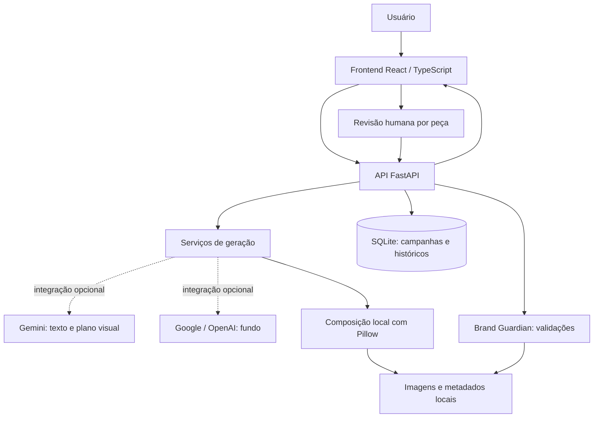

# Zyntra AI — Creative Factory + Brand Guardian

O **Zyntra AI** apoia equipes de marketing na criação, personalização, validação e aprovação de campanhas publicitárias. O projeto foi desenvolvido como **MVP para o desafio da Pague Menos no hackathon Alura/Oracle ONE**, com entrega em 26/10/2026.

A solução reúne uma interface de trabalho, geração opcional com inteligência artificial, composição visual local e verificação de regras, mantendo a decisão de aprovação com uma pessoa.

> Os produtos, preços, ofertas e regras de marca da demonstração são fictícios. Não representam produtos, condições comerciais ou políticas oficiais da Pague Menos.

## 1. Problema identificado

Produzir uma campanha exige transformar um briefing em textos e peças adequados a cada canal, conferir informações comerciais e revisar a comunicação antes da divulgação. Equipes de marketing precisam lidar com:

- Tempo de produção e adaptação de conteúdos para diferentes canais.
- Trabalho manual de composição, ajustes e revisão.
- Risco de inconsistências na identidade e na comunicação da marca.
- Conferência de preços, ofertas e informações obrigatórias.
- Necessidade de uma aprovação humana rastreável.

## 2. Nossa solução

**Criação → Validação → Aprovação**

- **Creative Factory:** transforma o briefing e os dados autorizados do catálogo em textos e peças visuais, com opções de personalização.
- **Brand Guardian:** executa verificações objetivas de marca, conteúdo, dados comerciais e composição, apresentando resultados e severidades.
- **Revisão humana:** permite analisar, aprovar ou rejeitar cada peça, registrando identificação, comentário e histórico.

Campanhas, validações e revisões são persistidas em SQLite. As imagens e seus metadados ficam em armazenamento local, com integridade SHA-256.

## 3. Creative Factory

### Briefing e conteúdo

- Seleção de produto do catálogo e criação de campanha com nome, objetivo, público-alvo e canais.
- Conteúdo textual para **feed, story e banner**; composição visual para **feed e story**.
- Tema de campanha, inclusive personalizado, e cinco estilos visuais: Minimalista, Moderno, Acolhedor, Vibrante e Elegante.
- Exibição opcional do preço na publicidade. O valor autorizado continua registrado internamente para conferência.
- Geração de textos e planejamento visual com Gemini, quando configurado, ou geração demonstrativa determinística com o serviço mock.
- Consulta, pesquisa e detalhe de campanhas, com peças, dados do briefing e histórico.

### Geração de imagens e composição

| Etapa | Funcionamento |
|---|---|
| Texto com IA | Gemini recebe briefing, catálogo e regras de marca. A resposta passa pelos contratos e validações existentes. |
| Fundo com IA | Os provedores visuais Google ou OpenAI geram um fundo, quando configurados. Essa configuração é independente do provedor textual. |
| Composição local | Pillow combina fundo, fotografia autorizada do produto, logotipo, textos e elementos do template. Essa etapa não chama IA. |
| Demonstração visual | O provedor visual mock carrega um PNG local configurado; não gera uma imagem por IA. |

A composição oferece templates com produto centralizado ou à direita, preservando a proporção da fotografia e do logotipo. Há prévia e exportação em **PNG**, nos formatos feed (1080 × 1350) e story (1080 × 1920).

Na interface, **Editar peça** permite ajustar título, subtítulo, CTA, estilo, template e publicação do preço. Também é possível enviar um fundo PNG/JPEG autorizado para feed/story e recompor com o fundo existente ou reutilizar o de outra peça do mesmo canal e campanha. O upload é usado como fundo; não é interpretado pelo Gemini como referência visual.

Produto, preço autorizado, oferta e disclaimer não são campos livres de edição. Alterações relevantes exigem nova composição quando aplicável, validação e revisão; os históricos anteriores são preservados.

### Indisponibilidade e alternativas explícitas

O fallback **não acontece automaticamente**. Para falhas elegíveis de cota, limite de requisições ou indisponibilidade temporária, a interface preserva o trabalho e oferece a ação correspondente:

- **Continuar com versão demonstrativa:** usa o mock textual existente, identificando o conteúdo como demonstrativo.
- **Criar peça com imagens disponíveis:** compõe com fotografia, logotipo e recursos locais, sem gerar um novo fundo por IA. Também atende ao modo visual desabilitado, quando a opção é disponibilizada.

Erros de briefing, validação ou bloqueio de segurança não autorizam fallback textual para mock. A origem dos textos e das peças visuais é identificada, e o usuário pode tentar o provedor novamente posteriormente. Uma falha visual não invalida automaticamente um texto válido.

## 4. Brand Guardian

O Brand Guardian aplica regras determinísticas configuradas no projeto. Entre as verificações implementadas estão:

- Existência do produto e correspondência de nome, preço e oferta com o catálogo.
- Campos obrigatórios, expressões exigidas e proibidas, limites por canal e informações de marca/disclaimers.
- Condições comerciais reconhecidas nos textos e respeito à preferência de ocultar preço.
- Integridade SHA-256, fotografia autorizada, logotipo, fonte e metadados da composição.
- Dimensões do PNG, templates, margens de segurança e sobreposição dos elementos.

Os resultados mostram verificações aprovadas e violações, com severidade **informativa, aviso ou crítica**. Violações críticas e validação desatualizada impedem a aprovação. O relatório detalhado pode ser expandido na interface, e as execuções anteriores ficam no histórico.

**A validação visual não realiza OCR completo das embalagens ou fotografias**, nem garante interpretação semântica de todas as alegações presentes em um fundo. A conferência humana permanece necessária.

## 5. Revisão e aprovação humana

Cada peça pode ser aprovada ou rejeitada com **identificação do revisor** e comentário opcional. A interface solicita confirmação da decisão e apresenta seu histórico com data e identificação.

A aprovação exige estado **Validada**, validação atual bem-sucedida e conteúdo compatível com os dados e assets conferidos. Alterações relevantes tornam necessária uma nova validação; uma peça rejeitada pode ser reavaliada após os ajustes.

A inteligência artificial auxilia a produção, mas **não aprova automaticamente** e não substitui o responsável pela revisão. As identificações do MVP são autodeclaradas, sem autenticação de identidade.

## 6. Catálogo fictício

O [catálogo atual](backend/app/data/products.json) contém **seis produtos**:

| ID | Produto | Categoria | Preço fictício |
|---|---|---|---|
| `syn-001` | Sabonete Brisa | Higiene | R$ 8,90 |
| `syn-002` | Shampoo Aurora | Cabelos | R$ 24,50 |
| `syn-003` | Hidratante Nuvem | Cuidados pessoais | R$ 32,90 |
| `syn-004` | Escova Sorriso | Higiene bucal | R$ 12,00 |
| `syn-005` | Algodão Sereno | Acessórios | R$ 6,75 |
| `syn-006` | Protetor Solar Solara | Proteção solar | R$ 39,90 |

A oferta autorizada é **“Preço sintético de demonstração, sem desconto adicional.”** O Solara tem como descrição autorizada “Protetor solar facial fictício FPS 50, toque seco, 60 g.” Essas características pertencem ao produto fictício e não autorizam benefícios adicionais ou alegações médicas.

As fotografias são distribuídas pela API e reutilizadas pelo frontend e pelo compositor. Consulte a [integração das fotografias](docs/fotografias-produtos.md) e a [inclusão do Solara](docs/protetor-solar-solara.md), incluindo a ressalva sobre textos impressos no rótulo.

## 7. Tecnologias utilizadas

| Responsabilidade | Tecnologias |
|---|---|
| Backend e contratos | Python 3.13, FastAPI, Pydantic, Uvicorn |
| Frontend | React, TypeScript, Vite, React Router, Tailwind CSS |
| Comunicação e formulários | Axios, TanStack Query, React Hook Form, Zod |
| Persistência | SQLite e SQLAlchemy |
| IA opcional | Gemini para texto/planejamento; Google ou OpenAI para fundos |
| Composição e imagens | Pillow e armazenamento local com metadados/hash |
| Infraestrutura | Docker, Docker Compose e Nginx como proxy do frontend |
| Testes e qualidade | pytest, HTTPX, Vitest, Testing Library, TypeScript e ESLint |

As dependências estão em [requirements.txt](backend/requirements.txt) e [package.json](paguemenos-FRONT-END/package.json). O frontend possui `package-lock.json`; as dependências transitivas Python não possuem arquivo de lock.

## 8. Arquitetura da solução



O modo demonstrativo funciona sem serviços externos. No Docker, o Nginx encaminha `/api` para o backend. Banco e imagens usam os volumes `backend_data` e `creative_images`, respectivamente.

### Estrutura do repositório

```text
backend/                 API, serviços, catálogo, assets e testes
paguemenos-FRONT-END/     Interface React, contratos e testes
docs/                    Documentação de integração e funcionalidades
assets/produtos/         Fotografias originais fornecidas
compose.yaml             Serviços e volumes do ambiente local
```

## 9. Como executar

### Com Docker Compose

Pré-requisitos: Git e Docker com suporte a Compose (no Windows, Docker Desktop ativo). Na pasta em que deseja manter o projeto:

```powershell
git clone https://github.com/GabrielAraujoFS/Paguamenos.git
cd Paguamenos
docker compose up --build -d
```

A configuração padrão usa `GENERATION_PROVIDER=mock` e `IMAGE_GENERATION_PROVIDER=disabled`: não exige chave de API. Após criar uma campanha, a opção explícita de recursos locais permite compor uma peça sem IA externa.

- **Frontend:** [http://localhost:5173](http://localhost:5173)
- **Swagger:** [http://localhost:8000/docs](http://localhost:8000/docs)
- **Saúde da API:** [http://localhost:8000/health](http://localhost:8000/health)
- **Catálogo pelo proxy:** [http://localhost:5173/api/products](http://localhost:5173/api/products)

As portas 5173 e 8000 são publicadas somente em `127.0.0.1`. Se estiverem ocupadas, ajuste os mapeamentos locais em `compose.yaml`. Em caso de problemas de build com arquivos do OneDrive, prefira clonar o repositório em uma pasta local não sincronizada.

Para encerrar os contêineres e manter os dados:

```powershell
docker compose down
```

Os volumes preservam banco e imagens entre reinicializações. Não remova os volumes se precisar manter campanhas, arquivos e revisões.

### IA externa opcional

Para utilizar provedores externos no Compose, copie o exemplo **somente se ainda não houver `.env`**:

```powershell
if (-not (Test-Path .env)) { Copy-Item .env.example .env }
```

Edite apenas as configurações dos provedores que pretende usar:

| Uso | Configuração no `.env` da raiz |
|---|---|
| Textos/planejamento Gemini | `GENERATION_PROVIDER=gemini`, `GEMINI_API_KEY` e `GEMINI_MODEL` |
| Fundos Google | `IMAGE_GENERATION_PROVIDER=google`, `GEMINI_API_KEY`, `IMAGE_MODEL` e `IMAGE_SIZE` |
| Fundos OpenAI | `IMAGE_GENERATION_PROVIDER=openai` e `OPENAI_API_KEY` |
| Fundo demonstrativo fixo | `IMAGE_GENERATION_PROVIDER=mock` e `IMAGE_MOCK_PATH`, com caminho de PNG acessível dentro do backend |

Os nomes de modelos e os limites de tempo/tentativas configurados estão em [.env.example](.env.example). São configurações do projeto, não garantia de disponibilidade na conta do provedor. Consulte o [guia textual](backend/docs/geracao-ia.md) e o [guia visual](backend/docs/composicao.md) antes de habilitar chamadas externas, que podem consumir cota ou gerar cobrança.

Depois de ajustar a configuração, reaplique `docker compose up --build -d`. As chaves ficam somente no backend: não as coloque em variáveis `VITE_`, código, capturas de tela ou commits. O `.env` é ignorado pelo Git.

### Desenvolvimento local sem Docker

Backend, em PowerShell, a partir da raiz (Python 3.13):

```powershell
py -3.13 -m venv .venv
.\.venv\Scripts\python.exe -m pip install -r backend\requirements.txt
cd backend
$env:GENERATION_PROVIDER = 'mock'
$env:IMAGE_GENERATION_PROVIDER = 'disabled'
..\.venv\Scripts\python.exe -m uvicorn app.main:app --host 127.0.0.1 --port 8000
```

O SQLite local é criado automaticamente. Na execução direta, arquivos `.env` não são carregados automaticamente; use variáveis do processo. Veja [backend/.env.example](backend/.env.example) para opções adicionais.

Em outro terminal, a partir da raiz, com Node.js 22 compatível com as dependências do projeto e npm:

```powershell
cd paguemenos-FRONT-END
npm ci
if (-not (Test-Path .env.local)) { Copy-Item .env.example .env.local }
npm run dev
```

O frontend local usa por padrão `http://127.0.0.1:8000`; ajuste `VITE_API_BASE_URL` em `.env.local` se necessário. O backend aceita a origem local `http://localhost:5173`. Consulte os guias de [backend](backend/README.md) e [frontend](paguemenos-FRONT-END/README.md) para mais detalhes.

## 10. Como utilizar o MVP

1. Acesse a interface e confira **Conexão** para verificar o backend.
2. Abra **Catálogo**, escolha um produto e clique em **Ver produto** → **Criar briefing com este produto**, ou acesse **Nova campanha**.
3. Preencha nome, objetivo, público-alvo e canais. Selecione tema, estilo e se o preço deve aparecer; clique em **Gerar campanha**.
4. Em **Campanhas**, abra o cartão da campanha e confira os textos e dados completos. Use **Editar peça** para os ajustes permitidos, informando sua identificação.
5. Para feed/story, clique em **Gerar imagem**. Se a geração estiver indisponível e a alternativa for oferecida, escolha **Criar peça com imagens disponíveis**. Também é possível enviar um fundo pelo editor e clicar em **Recompor com fundo existente**.
6. Clique em **Validar campanha** e confira as aprovações, violações e severidades no relatório do **Brand Guardian**. Corrija e recomponha quando necessário, depois valide novamente.
7. Em **Revisão humana**, informe o revisor, acrescente comentário se desejar e clique em **Aprovar** ou **Rejeitar**, confirmando a decisão. Aprovar exige validação atual bem-sucedida.
8. Confira a prévia e use **Baixar PNG** quando a imagem estiver disponível. O download não substitui a aprovação; consulte também o histórico de validações, revisões, edições e imagens anteriores.

## 11. Testes e qualidade

Os testes automatizados usam dados isolados e provedores simulados. As verificações cobrem geração, erros de provedores, fallback explícito, catálogo, regras comerciais, composição, integridade das imagens, revisão humana e compatibilidade com históricos. Não é necessário usar chaves reais.

Após instalar as dependências, execute no PowerShell, a partir da raiz:

```powershell
cd backend
$env:GENERATION_PROVIDER = 'mock'
$env:IMAGE_GENERATION_PROVIDER = 'disabled'
$env:DATABASE_URL = 'sqlite:///:memory:'
$env:IMAGE_STORAGE_ROOT = Join-Path $env:TEMP ('zyntra-tests-' + [guid]::NewGuid().ToString('N'))
..\.venv\Scripts\python.exe -m pytest -q -p no:cacheprovider
```

Testes de composição precisam de fonte disponível: as fixtures procuram Arial no Windows ou DejaVu Sans no Linux; a imagem Docker do backend instala DejaVu. As variáveis acima valem para o terminal atual; use outro terminal para retomar a aplicação com seu armazenamento habitual.

No frontend, a partir da raiz, em outro terminal:

```powershell
cd paguemenos-FRONT-END
npm ci
npm run test
npx tsc -b --pretty false
npm run lint
npm run build
```

O teste HTTP real do frontend é opt-in (`ZYNTRA_TEST_LIVE_API=1`) e exige backend isolado. A suíte padrão não o habilita. Não há contagens de aprovação apresentadas aqui como resultado atual: execute os comandos na versão que será avaliada. As verificações automatizadas complementam a conferência manual no navegador e não comprovam, por si só, a qualidade criativa de um provedor real.

## 12. Limitações do MVP

- Catálogo, dados comerciais e regras são demonstrativos; não há integração com catálogo, estoque ou políticas oficiais da Pague Menos.
- IA externa depende de configuração, acesso ao modelo, cota e disponibilidade do provedor. Texto, fundo gerado e composição local são etapas distintas.
- As verificações são objetivas e baseadas nas regras/padrões implementados; não substituem revisão jurídica, médica, publicitária ou de direitos de imagem.
- Não há OCR completo dos rótulos, análise semântica integral de fotografias ou interpretação multimodal do fundo enviado pela equipe.
- A revisão é por peça, com identificação autodeclarada. **Autenticação, autorização e proteção de acesso precisam ser implementadas antes de exposição pública.**
- A renderização usa tarefas no próprio processo da API, sem fila distribuída. Um reinício pode interromper o trabalho, exigindo nova solicitação explícita.
- Há edição orientada por templates, não um editor gráfico livre. Banner tem conteúdo textual, mas não composição PNG implementada.
- Não há publicação automática em redes sociais, gestão de mídia paga ou infraestrutura de produção com alta disponibilidade neste escopo.

## 13. Equipe

| Integrante | Responsabilidade |
|---|---|
| Paulo Douglas | Backend, APIs e integração |
| Alex | Frontend |
| Emilly | Product Owner |
| Gabriel | Scrum Master e coordenação |
| Duda | Apoio e testes |

## 14. Documentação complementar

- [Backend: instalação, API e fluxo no Swagger](backend/README.md)
- [Frontend: instalação e comandos](paguemenos-FRONT-END/README.md)
- [Contrato e handoff da integração](docs/FRONTEND_HANDOFF.md)
- [Orientações de integração da API](backend/docs/integracao.md)
- [OpenAPI exportado](backend/examples/openapi.json) e [exemplos de respostas](backend/examples/responses.json)
- [Configuração de regras de marca e campanha](backend/docs/configuracao.md)
- [Gemini: configuração e limitações](backend/docs/geracao-ia.md)
- [Composição visual e provedores](backend/docs/composicao.md)
- [Edição, fundos e histórico](docs/ferramentas-marketing.md)
- [Progresso do frontend](paguemenos-FRONT-END/docs/FRONTEND_PROGRESS.md)

Os documentos de progresso registram etapas e verificações em suas respectivas datas; não representam uma execução nova dos testes a cada consulta.

## 15. Considerações finais

O Zyntra AI demonstra como reunir automação, inteligência artificial opcional, validação de regras de marca e supervisão humana em um fluxo único de produção publicitária. Reduzir retrabalho e ampliar a produtividade são benefícios potenciais da abordagem, não resultados quantitativamente comprovados pelo MVP.
