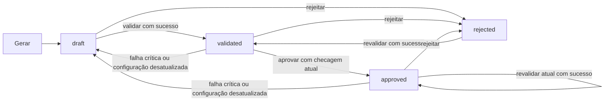

# Contrato da API — Creative Factory + Brand Guardian

## Continuação explícita após falha de IA (2026-10-26)

Falhas temporárias/429 de texto podem incluir `demo_token` em `error.details`. Somente após consentimento, repetir POST `/campaigns/generate` com esse parâmetro opcional e o mesmo briefing cria uma versão mock. O servidor exige oferta válida vinculada ao briefing/produto/regras; 409 indica oferta expirada/alterada. Erros de validação, segurança, autenticação ou HTTP 400 não autorizam fallback. O campo opcional `Campaign.generation` registra provider/model/data e identifica conteúdo demonstrativo, inclusive após reabrir a campanha.

`RenderRequest.use_local_assets` é opcional (false). Após falha visual elegível, essa opção solicita composição Pillow com assets locais, sem nova chamada de IA. `VisualMetadata.composition_source`, `fallback_reason` e `retry_after_seconds` indicam origem e diagnóstico. Falhas de renderização preservam o conteúdo validado e o PNG anterior; uma nova arte concluída exige revalidação. A origem do PNG também aparece em `X-Creative-Composition-Source`. Consulte [detalhes e limites](../../docs/fallback.md). Os demais contratos e as regras comerciais/Brand Guardian permanecem.

## Atualização do pipeline híbrido (2026-10-25)

O OpenAPI vivo do backend neste workspace acrescentou `POST /pieces/{piece_id}/render`, `GET /pieces/{piece_id}/render` e `GET /pieces/{piece_id}/image`. As afirmações antigas abaixo sobre inexistência de mídia e geração apenas textual descrevem a versão anterior.

`POST .../render` recebe `RenderRequest` (`request_id?`, UUID textual; `force?`, `regenerate_background?`, `source_piece_id?`) e responde `RenderStatus` com 202 quando inicia/processa, ou 200 quando já está composto ou bloqueado. `GET .../render` devolve o mesmo status. `visual.state` pode ser `pending`, `processing`, `background_ready`, `composed`, `blocked` ou `failed`; as referências `background`, `product_image` e `final_image` são `ImageReference` (`file_id`, `media_type`, `width?`, `height?`, `sha256`). O plano visual, template e metadados de geração estão dentro de `visual`, não no objeto público `Piece`.

`GET .../image` retorna o PNG final somente quando `visual.state` é `composed`, com `Content-Type: image/png`, `Cache-Control: private, no-store`, `Content-Disposition: inline` e cabeçalhos `X-Creative-Asset-Use: internal-preview` e `X-Creative-Approval-State`. A imagem é uma **prévia interna**, inclusive quando a peça está aprovada. A rota resolve exclusivamente a referência persistida da peça; o cliente não envia caminho nem ID de arquivo. Respostas tratadas incluem 404 para peça/imagem ausente e 409 para referência ou integridade inválida.

**Segurança:** não há autenticação nem autorização no backend atual. A rota de imagem e as operações de campanha/revisão não devem ser expostas publicamente sem controle de acesso na borda ou autenticação implementada no servidor. `reviewer_id` continua autodeclarado. O frontend não interpreta a prévia nem o download como publicação.

Fonte: implementação FastAPI em `backend/app/main.py`, `backend/app/api/`, `backend/app/schemas/` e serviços; `docs/openapi.json` é cópia da especificação exportada pelo backend, cuja igualdade com `/openapi.json` é verificada em `backend/tests/test_brand_configuration.py`. Esta referência descreve também regras de execução que o OpenAPI não expressa. Versão da aplicação: `0.1.0`. URL local usual: `http://127.0.0.1:8000`; não há prefixo `/api` nem versionamento de rota.

**Atualização de 2026-10-24:** o OpenAPI vivo acrescentou `GET /campaigns`, detalhado abaixo. As menções antigas a sete endpoints e à ausência de paginação referem-se ao contrato anterior; a listagem agora é a exceção com paginação e filtros próprios.

## Convenções transversais

- Todos os sete endpoints abaixo são públicos no código atual: nenhuma dependência de autenticação, autorização, sessão de usuário, cookie, JWT, chave de API recebida ou perfil. `reviewer_id` é texto fornecido pelo cliente, sem verificação de identidade. Não trate essa identificação como prova de autorização.
- `GET` não exige body. Os três `POST` com JSON precisam de `Content-Type: application/json` (`generate` e `review`); `POST .../validate` não possui body nem header obrigatório de aplicação. `Accept: application/json` é recomendado, não exigido. Não envie `Authorization` por exigência desta API.
- A listagem `GET /campaigns` aceita query de paginação, busca e filtros descrita abaixo. As demais rotas não têm query de negócio. Não há ordenação configurável, upload, download ou endpoints de mídia. IDs são strings; os IDs criados de campanha, peça, validação e revisão são UUIDs textuais. O catálogo usa IDs como `syn-001`.
- Datas da resposta são strings ISO 8601 em UTC, serializadas com sufixo `Z` pelo Pydantic. Preços são **strings decimais** no JSON, como `"8.90"`; preserve centavos e não use aritmética binária para valores comerciais.
- Sucessos retornam JSON diretamente, sem envelope. Erros HTTP tratados retornam `{ "error": { "code": string, "message": string, "details": object[] } }`. Falhas de validação de entrada usam `details` com `{field,message,type}` e nomes como `body.channels.0`. Os textos de validação Pydantic podem variar; use `code` e `field` como sinais estáveis.
- `404`, `409` e `422` aparecem nos metadados globais do OpenAPI, inclusive em rotas onde não há ramo explícito para eles. O `502` de geração é implementado, mas não está declarado no OpenAPI. A tabela por endpoint abaixo distingue respostas implementadas. Erros inesperados 500 e falhas de infraestrutura não têm envelope garantido.
- `/docs`, `/redoc` e `/openapi.json` são rotas automáticas de documentação do FastAPI, não operações de domínio; continuam disponíveis pela configuração padrão. `OPTIONS` de preflight é tratado pelo middleware CORS, não por uma rota de negócio.

## Índice de rotas de domínio

| Método | Caminho | Finalidade | Sucesso | Erros explícitos |
|---|---|---|---|---|
| GET | `/health` | Saúde e provedor configurado | 200 `Health` | nenhum ramo explícito |
| GET | `/products` | Catálogo completo | 200 `Product[]` | nenhum ramo explícito |
| GET | `/products/{product_id}` | Produto por ID | 200 `Product` | 404 `PRODUCT_NOT_FOUND` |
| GET | `/campaigns` | Listar campanhas com paginação e filtros | 200 `CampaignPage` | 422 para query inválida |
| POST | `/campaigns/generate` | Gerar e persistir campanha | 201 `Campaign` | 404 `PRODUCT_NOT_FOUND`; 422 `INVALID_REQUEST`; 502 de geração |
| GET | `/campaigns/{campaign_id}` | Consultar campanha e invalidar estado desatualizado | 200 `Campaign` | 404 `CAMPAIGN_NOT_FOUND` |
| POST | `/campaigns/{campaign_id}/validate` | Validar todas as peças da campanha | 200 `Campaign` | 404 `CAMPAIGN_NOT_FOUND` |
| POST | `/pieces/{piece_id}/review` | Registrar decisão sobre uma peça | 200 `Piece` | 404 `PIECE_NOT_FOUND`; 409 `APPROVAL_BLOCKED`; 422 `INVALID_REQUEST` |

## Schemas públicos e tipagem TypeScript

Todos os campos abaixo são obrigatórios nas **respostas**, inclusive arrays vazios e `comment: null`; apenas `additional_instructions` e `comment` podem ser omitidos nas **requisições** e se tornam `null`. Os modelos de entrada proíbem campos extras e removem espaços das bordas de strings. Os limites descritos são da validação Pydantic, enquanto limites editoriais por canal são verificados depois, na validação da campanha.

```ts
type Channel = 'feed' | 'story' | 'banner';
type PieceState = 'draft' | 'validated' | 'approved' | 'rejected';
type Decision = 'approved' | 'rejected';
type Severity = 'info' | 'warning' | 'critical';
type DecimalString = string; // JSON: "8.90", duas casas, sem moeda
type ISODateTime = string; // UTC ISO 8601, normalmente termina em Z

interface Briefing {
  campaign_name: string; product_id: string; objective: string;
  target_audience: string; channels: Channel[];
  additional_instructions: string | null;
}
type GenerateRequest = Omit<Briefing, 'additional_instructions'> &
  { additional_instructions?: string | null };
interface Product {
  id: string; name: string; description: string; category: string;
  price: DecimalString; authorized_offer: string;
}
interface ValidationResult {
  rule_code: string; severity: Severity; message: string;
  field: string; passed: boolean;
}
interface ValidationRun {
  id: string; created_at: ISODateTime; fingerprint: string;
  success: boolean; results: ValidationResult[];
}
interface ReviewRequest {
  decision: Decision; reviewer_id: string; comment?: string | null;
}
interface ReviewRecord {
  id: string; created_at: ISODateTime; fingerprint: string;
  decision: Decision; reviewer_id: string; comment: string | null;
}
interface Piece {
  id: string; campaign_id: string; channel: Channel;
  title: string; subtitle: string; cta: string; disclaimer: string;
  product_id: string; product_name: string; price: DecimalString;
  authorized_offer: string; state: PieceState;
  validations: ValidationRun[]; reviews: ReviewRecord[];
}
interface Campaign {
  id: string; created_at: ISODateTime; briefing: Briefing; pieces: Piece[];
}
interface ApiError {
  error: { code: string; message: string;
    details: Array<{field?: string; message?: string; type?: string} | Record<string, unknown>> };
}
interface Health { status: string; generation_provider: string; }
```

| Modelo de entrada | Obrigatórios | Opcionais / limites |
|---|---|---|
| `Briefing` | `campaign_name`, `product_id`, `objective`, `target_audience`: strings de 1 a 2000 caracteres após trim; `channels`: 1 a 3 canais distintos do enum | `additional_instructions`: string de até 4000 caracteres ou `null`; vazia é aceita |
| `ReviewRequest` | `decision`: enum; `reviewer_id`: string de 1 a 100 caracteres após trim | `comment`: string de até 2000 caracteres ou `null`; vazia é aceita |
| `Product` (leitura) | todos os campos; textos de 1 a 2000 caracteres; `price` Decimal >= 0, máximo 10 dígitos e 2 decimais | nenhum campo opcional; não existe escrita de produto pela API |

`GeneratedText` é **contrato interno** do gerador (`channel`, `title`, `subtitle`, `cta`, textos de 1 a 2000 caracteres, sem campos extras); não é request do frontend. Tabelas SQLite internas: `CampaignModel` guarda `briefing` JSON e peças; `PieceModel` guarda `content` JSON, `state` e `position`; `ValidationModel` guarda `fingerprint`, `success` e `results` JSON; `ReviewModel` guarda decisão, revisor, comentário e fingerprint. O objeto público `Campaign` é montado por `campaign_output` e `piece_output`, não é serialização direta das tabelas. O catálogo e as regras são arquivos JSON do servidor, fora do SQLite (`backend/app/models/__init__.py`, `backend/app/services/catalog.py`, `backend/app/services/workflow.py`).

### Exemplo completo do objeto `Campaign` recém-gerado

IDs e datas são ilustrativos; os textos abaixo correspondem ao mock e à configuração atual para `syn-001` e canal `feed`. Use sempre IDs devolvidos pela execução.

```json
{
  "id": "55e27e3b-0e89-4347-b716-63b85cf7cff4",
  "created_at": "2026-10-20T04:14:41.055582Z",
  "briefing": {
    "campaign_name": "Campanha Aurora", "product_id": "syn-001",
    "objective": "Divulgar produto sintético",
    "target_audience": "Adultos interessados em higiene pessoal",
    "channels": ["feed"], "additional_instructions": null
  },
  "pieces": [{
    "id": "dc6e6903-ea68-478a-9870-daf816f74e21",
    "campaign_id": "55e27e3b-0e89-4347-b716-63b85cf7cff4",
    "channel": "feed", "title": "Marca de demonstração: conheça Sabonete Brisa",
    "subtitle": "Sabonete corporal fictício de uso diário. Cuidado com informação clara.",
    "cta": "Conheça o produto", "disclaimer": "Campanha fictícia. Dados sintéticos.",
    "product_id": "syn-001", "product_name": "Sabonete Brisa",
    "price": "8.90",
    "authorized_offer": "Preço sintético de demonstração, sem desconto adicional.",
    "state": "draft", "validations": [], "reviews": []
  }]
}
```

## Endpoints detalhados

### `GET /campaigns` (confirmado no OpenAPI vivo)

Sem autenticação e sem prefixo `/api`. Query opcional: `page` inteiro a partir de 1 (padrão 1), `page_size` inteiro entre 1 e 100 (padrão 20), `status` em `draft | validated | approved | rejected`, `channel` em `feed | story | banner`, `search` string não vazia. A resposta 200 é `{ items: Campaign[], total: number, page: number, page_size: number, total_pages: number }`. `total` refere-se à consulta filtrada. Cada item usa o mesmo schema `Campaign` abaixo. O filtro `status` refere-se a estado de peça; o objeto `Campaign` não ganhou status agregado. Não há ordenação configurável, descrição ou data de atualização de campanha. Confirmação: OpenAPI e resposta HTTP do backend local em 2026-10-24.

### `GET /health`

Sem parâmetros, body, autenticação ou header obrigatório. Retorna 200 `Health`:

```json
{"status":"ok","generation_provider":"mock"}
```

`generation_provider` é `mock`, `gemini` ou `custom` conforme a classe instalada; o schema OpenAPI só o tipa como `string`. Indica configuração, não conectividade do provedor. Não há 404/409/422 implementados nesta rota (`backend/app/main.py`).

### `GET /products`

Sem parâmetros, body, autenticação ou header obrigatório. Retorna 200 array completo, na ordem do arquivo local; **não há paginação**:

```json
[{"id":"syn-001","name":"Sabonete Brisa","description":"Sabonete corporal fictício de uso diário.","category":"higiene","price":"8.90","authorized_offer":"Preço sintético de demonstração, sem desconto adicional."}]
```

O exemplo mostra um item do array; a configuração atual contém cinco produtos `syn-001` a `syn-005`. O conteúdo pode mudar no servidor. Não há ramo de erro de domínio explícito (`backend/app/api/products.py`, `backend/app/data/products.json`).

### `GET /products/{product_id}`

`product_id`: string no path, correspondência exata e sensível a maiúsculas com o catálogo. Sem query, body, autenticação ou header obrigatório. Retorna 200 `Product`, por exemplo o objeto `syn-001` acima. Inexistente: 404:

```json
{"error":{"code":"PRODUCT_NOT_FOUND","message":"Produto não encontrado.","details":[]}}
```

### `POST /campaigns/generate`

`Content-Type: application/json`; body `GenerateRequest`. Sem path/query ou autenticação. Exemplo:

```http
POST /campaigns/generate HTTP/1.1
Content-Type: application/json

{"campaign_name":"Campanha Aurora","product_id":"syn-001","objective":"Divulgar produto sintético","target_audience":"Adultos interessados em higiene pessoal","channels":["feed"],"additional_instructions":null}
```

Retorna **201 `Campaign`**, com uma peça por canal solicitado, na ordem de `channels`, inicialmente `draft` e com históricos vazios. Veja o JSON completo acima. `additional_instructions` omitido aparece como `null` no briefing devolvido. Produto inexistente: 404 `PRODUCT_NOT_FOUND`. Body inválido, canal desconhecido/duplicado, array vazio/maior que três, texto obrigatório vazio, campo extra ou JSON malformado: 422 `INVALID_REQUEST`. Exemplo:

```json
{"error":{"code":"INVALID_REQUEST","message":"Dados de entrada inválidos.","details":[{"field":"body.channels","message":"Value error, Os canais não podem se repetir.","type":"value_error"}]}}
```

Falhas previstas de geração: **502** com `details: []` e códigos `GENERATION_TIMEOUT`, `GENERATION_UNAVAILABLE`, `GENERATION_AUTH_ERROR`, `GENERATION_RATE_LIMIT`, `GENERATION_CONTRACT_ERROR`. Este último também cobre saída do gerador inválida ou conjunto de canais divergente. O mock não usa rede; Gemini é opcional, sem retry/fallback automático. Falha prevista não persiste campanha. O servidor insere nome, preço, oferta e disclaimer de fontes locais; não envie esses campos no briefing. O mock usa templates e não interpreta livremente objetivo/público/instruções; Gemini recebe o contexto em prompt. Mesmo com geração bem-sucedida, conteúdo **não** foi validado nem aprovado (`backend/app/api/campaigns.py`, `backend/app/services/generation.py`, `backend/app/services/gemini.py`).

### `GET /campaigns/{campaign_id}`

`campaign_id`: string no path. Sem query, body, autenticação ou header obrigatório. Retorna 200 `Campaign` com peças, histórico completo de validações e revisões. Exemplo: o objeto da geração acima, eventualmente com arrays preenchidos. Retorna 404 `CAMPAIGN_NOT_FOUND` com mensagem `Campanha não encontrada.` para ID desconhecido. A consulta recalcula o fingerprint; peças `validated` ou `approved` cuja última validação não corresponde mais ao conteúdo/produto/regras atuais (ou falhou) passam a `draft`, preservando históricos. Portanto um `GET` pode persistir mudança de estado e a interface deve usar o estado da resposta atual (`backend/app/api/campaigns.py`, `backend/app/services/workflow.py`).

### `POST /campaigns/{campaign_id}/validate`

`campaign_id`: string no path. Sem query, body, autenticação ou header obrigatório. Exemplo: `POST /campaigns/55e27e3b-0e89-4347-b716-63b85cf7cff4/validate` sem body. Retorna 200 `Campaign` completo. Acrescenta **um** `ValidationRun` a cada peça; repetição acrescenta novos registros, não é operação idempotente. Exemplo de fragmento da resposta dentro de `pieces[0]`:

```json
{"state":"validated","validations":[{"id":"9ad507b8-996c-41f1-bc15-05e224da88ee","created_at":"2026-10-20T04:14:41.133083Z","fingerprint":"4cdebfb8a9816130c68e77f99f6d131a98c19b588979652f0497fdb31ca59e7e","success":true,"results":[{"rule_code":"PRODUCT_EXISTS","severity":"critical","message":"OK: Produto deve existir no catálogo.","field":"product_id","passed":true}]}]}
```

O fragmento omite outros campos da peça e resultados apenas para leitura; a resposta real inclui o `Campaign` inteiro e **todos** os resultados. `success` significa que todos os resultados de severidade `critical` passaram; falhas `warning`/`info` não bloqueiam. Com sucesso, estado vira `validated`, ou permanece `approved` se já era aprovado e o fingerprint ainda é o mesmo. Com falha crítica vira `draft`. Uma peça `rejected` que passa volta a `validated`. Campanha desconhecida: 404 `CAMPAIGN_NOT_FOUND`. Não há 409 para falha das regras: o HTTP continua 200 e o insucesso vem em `success`/`results` (`backend/app/api/campaigns.py`, `backend/app/services/workflow.py`).

### `POST /pieces/{piece_id}/review`

`piece_id`: string no path. `Content-Type: application/json`; body `ReviewRequest`; sem query ou autenticação. Exemplo:

```http
POST /pieces/dc6e6903-ea68-478a-9870-daf816f74e21/review HTTP/1.1
Content-Type: application/json

{"decision":"approved","reviewer_id":"revisor-demo","comment":"Revisado manualmente."}
```

Retorna 200 `Piece` completo. Para a peça do exemplo, a resposta terá os mesmos campos de conteúdo, `state: "approved"`, as validações anteriores e um registro adicional:

```json
{"id":"a53b632a-90d2-42b9-9323-d3df64035480a","created_at":"2026-10-20T04:15:04.001000Z","decision":"approved","reviewer_id":"revisor-demo","comment":"Revisado manualmente.","fingerprint":"4cdebfb8a9816130c68e77f99f6d131a98c19b588979652f0497fdb31ca59e7e"}
```

O JSON acima é **um elemento** de `reviews`, não a resposta inteira; a resposta inteira segue `Piece` mostrado no schema e no exemplo da campanha. Aprovação exige estado `validated`, última validação `success: true`, fingerprint atual e uma nova checagem crítica em tempo real. Caso contrário: 409:

```json
{"error":{"code":"APPROVAL_BLOCKED","message":"Aprovação exige validação atual bem-sucedida e estado validated.","details":[]}}
```

Rejeição (`decision: "rejected"`) é aceita em qualquer estado existente, inclusive `draft` e `approved`; o servidor registra nova revisão e define `rejected`. Uma aprovação repetida diretamente enquanto o estado é `approved` é bloqueada: revalidar uma peça aprovada e ainda atual preserva `approved`, sem criar outra aprovação. Após rejeição, uma nova validação bem-sucedida coloca a peça em `validated`, permitindo outra decisão. Rejeitar novamente cria outro registro. Peça desconhecida: 404 `PIECE_NOT_FOUND`, mensagem `Peça não encontrada.`. Body inválido: 422 `INVALID_REQUEST` (`backend/app/api/reviews.py`).

## Regras de validação e estados



O fingerprint SHA-256 cobre conteúdo da peça, produto de catálogo atual e configuração completa das regras; é um indicador de frescor, não um token de autenticação. A verificação de desatualização em consulta/revisão afeta apenas peças `validated` e `approved`. O histórico antigo não é excluído; `reviews` anteriores não representam aprovação do estado atual. O estado é **por peça**, sem estado agregado de campanha.

| Código de regra em `ValidationResult` | Campo/efeito |
|---|---|
| `PRODUCT_EXISTS`, `PRICE_MATCH`, `PRODUCT_NAME_MATCH`, `OFFER_MATCH` | Existência e igualdade com o catálogo; sempre críticos. |
| `REQUIRED_FIELD`, `CHANNEL_ALLOWED` | Campos essenciais não vazios e canal permitido pelas regras; sempre críticos. |
| `CHARACTER_LIMIT` | Limite por campo/canal; severidade configurável (`critical` por padrão). |
| `REQUIRED_INFORMATION` | Expressões obrigatórias por campo; severidade configurável. |
| `REQUIRED_EXPRESSION`, `FORBIDDEN_EXPRESSION` | Expressões configuradas, por campo e canal; severidade por regra. |
| `TEXT_PRICE_MATCH`, `TEXT_OFFER_MATCH` | Verificação sintática limitada de valores e ofertas nos quatro campos textuais; crítica. |

Configuração **atual** em `backend/app/data/brand_rules.json`: `feed`, `story`, `banner`; limites `title: 90`, `subtitle: 240`, `cta: 40` em cada canal; disclaimer deve conter `Campanha fictícia. Dados sintéticos.`; proíbe `cura garantida` e `resultado garantido` nos campos textuais; exige que preços estruturados correspondam ao catálogo; a política textual `catalog_only` aceita preço reconhecido em formato `R$ 8,90` somente se coincidir com o catálogo. Termos como desconto/promoção e padrões de percentual/oferta exigem a oferta autorizada completa no mesmo campo. Normalização de expressões ignora caixa, acentos e espaços repetidos, preservando pontuação. As regras são lidas do arquivo em cada operação relevante e **não são expostas por endpoint**; a interface não deve hardcodear seus valores como contrato permanente. O número e a ordem de `results` podem mudar. A checagem textual é sintática, não comprova conformidade semântica, clínica ou jurídica (`backend/app/services/validation.py`, `backend/app/schemas/configuration.py`).

## Autenticação, autorização e erros 401/403

Não existem rotas de login, logout, refresh, recuperação de senha ou gerenciamento de usuários; tampouco há middleware/dependências que autorizem ações. O SQLite `session` de `backend/app/api/dependencies.py` é uma **sessão de banco**, não de usuário. Assim, a matriz efetiva é:

| Funcionalidade | Endpoint | Perfil/permissão implementado |
|---|---|---|
| Saúde e catálogo | `/health`, `/products`, `/products/{product_id}` | acesso público |
| Gerar e consultar campanha | `/campaigns/generate`, `/campaigns/{campaign_id}` | acesso público |
| Validar campanha | `/campaigns/{campaign_id}/validate` | acesso público |
| Aprovar/rejeitar peça | `/pieces/{piece_id}/review` | acesso público; `reviewer_id` autodeclarado |

O aplicativo não emite 401/403 por regras próprias. Se um proxy externo acrescentar autenticação, seu contrato precisa ser definido fora deste backend. O frontend deve tratar 401/403 como erros HTTP inesperados/de infraestrutura e mostrar mensagem apropriada, sem tentar refresh token ou redirecionar para login inexistente. **Não use restrições de rota como segurança real**; qualquer cliente que alcance a API pode revisar peças.

## CORS e restrições de integração

`CORS_ORIGINS` contém origens explícitas separadas por vírgula; padrão `http://localhost:5173`. Somente `http`/`https` e hosts locais `localhost`, `127.0.0.1` ou `::1`, sem caminho/query/fragmento/credenciais. `http://127.0.0.1:5173` precisa ser adicionado separadamente. Middleware permite métodos `GET`, `POST` e header `Content-Type`; `allow_credentials=False`. Preflight de origem não autorizada retorna 400 pelo middleware. Não há suporte CORS para cabeçalho `Authorization` ou outras origens sem alterar configuração/código. Configuração inválida impede iniciar (`backend/app/main.py`, `backend/tests/test_api.py`).
