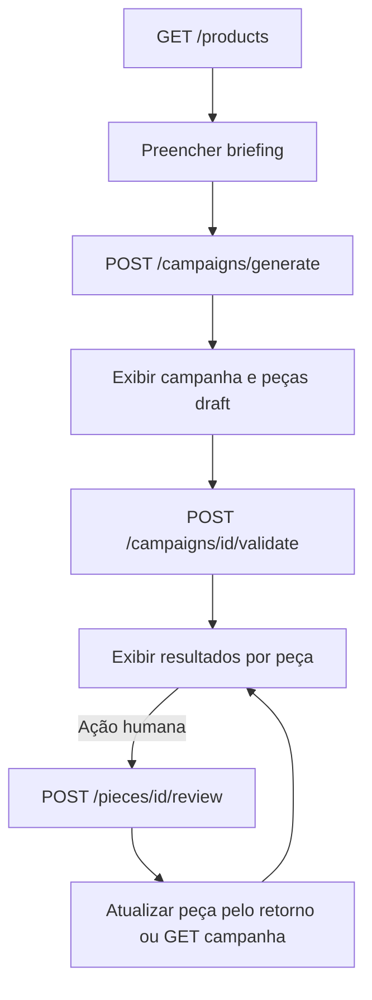

# Handoff técnico para o frontend — Creative Factory + Brand Guardian

**Atualização de 2026-10-25:** o backend deste workspace implementa planejamento visual, renderização híbrida e entrega de PNG. A tela `/campanhas/:campaignId` usa as rotas de renderização e prévia documentadas em [API_CONTRACT.md](API_CONTRACT.md). Os parágrafos históricos abaixo que indicam ausência de imagens e de download antecedem essa atualização. A prévia precisa de proteção de acesso antes de exposição pública.

Este documento é autossuficiente para implementar a interface do **MVP local**. A referência campo a campo e os exemplos HTTP estão em [API_CONTRACT.md](API_CONTRACT.md); a especificação exportada e verificada está em [openapi.json](openapi.json); a sequência de trabalho está em [FRONTEND_IMPLEMENTATION_PLAN.md](FRONTEND_IMPLEMENTATION_PLAN.md). Os caminhos `backend/...` citados permitem auditoria, mas o frontend não precisa do código do backend para seguir o contrato descrito aqui.

**Atualização de 2026-10-24:** o backend vivo agora inclui `GET /campaigns` com paginação e filtros `status`, `channel` e `search`. A resposta `CampaignPage` contém `items`, `total`, `page`, `page_size` e `total_pages`. Consulte [API_CONTRACT.md](API_CONTRACT.md) para os limites. As declarações antigas abaixo sobre ausência de listagem representam o contrato anterior.

## 1. Escopo confirmado e arquitetura do servidor

A aplicação cria campanhas textuais sintéticas para produtos de um catálogo local. O fluxo é **briefing → geração de uma peça por canal → validação objetiva de todas as peças → decisão humana por peça**. A aprovação é explícita e exige validação atual bem-sucedida. Há sete endpoints de domínio/saúde, todos descritos abaixo. Não há imagem, arquivo de campanha, publicação, edição, cadastro de produto, dashboard ou autenticação implementados.

| Aspecto | Implementação confirmada |
|---|---|
| Linguagem/runtime | Python 3.13 é o runtime documentado pelo projeto; não há limite de versão Python declarado em `requirements.txt`. |
| API | FastAPI `0.135.1`, Pydantic `2.12.5`; OpenAPI 3.1.0, versão da aplicação `0.1.0`. |
| Persistência | SQLAlchemy `2.0.48`, SQLite apenas; banco padrão `sqlite:///./creative_factory.db`, tabelas criadas na inicialização, sem migrações. |
| Geração | Mock local determinístico por padrão; adaptador HTTPX `0.28.1` para Gemini opcional. Geração de texto somente. |
| Servidor/testes | Uvicorn `0.41.0`; pytest `9.0.2`; sem Docker/Compose no repositório. |
| Dados | Cinco produtos sintéticos em JSON local; regras de marca sintéticas em JSON local; campanhas, peças, validações e revisões em SQLite. |

Organização: `backend/app/main.py` monta API, tratamento de erro e CORS; `backend/app/api/` contém produtos, campanhas, revisão e dependências transacionais; `backend/app/schemas/` contém DTOs públicos e schemas internos de configuração; `backend/app/models/` define quatro tabelas; `backend/app/services/` contém catálogo, geração, Gemini, validação e máquina de estados; `backend/app/data/` guarda produtos e regras; `backend/tests/` verifica fluxos; `backend/examples/` guarda OpenAPI e respostas exportadas. O arquivo de regras é lido novamente em operações relevantes. O catálogo é lido novamente a cada busca. Não há endpoint para ler regras, cores ou configuração visual.

## 2. API em uma página

Base local típica: `http://127.0.0.1:8000` (sem `/api`). JSON em todas as respostas. `POST /campaigns/generate` e `POST /pieces/{piece_id}/review` recebem `Content-Type: application/json`. Nenhum token, cookie, header de usuário ou credencial é exigido. Sem query strings de negócio, paginação, pesquisa, filtros, ordenação, upload ou download.

| Método e rota | Entrada | Saída | Papel no fluxo |
|---|---|---|---|
| `GET /health` | nenhuma | 200 `{status, generation_provider}` | indicar servidor e provedor configurado |
| `GET /products` | nenhuma | 200 `Product[]` completo | preencher seleção de produto |
| `GET /products/{product_id}` | ID no path | 200 `Product`; 404 | detalhes do produto |
| `POST /campaigns/generate` | `Briefing` JSON | 201 `Campaign`; 404/422/502 | criar campanha e peças `draft` |
| `GET /campaigns/{campaign_id}` | ID no path | 200 `Campaign`; 404 | reabrir campanha pelo ID e obter estado atual |
| `POST /campaigns/{campaign_id}/validate` | ID no path, sem body | 200 `Campaign`; 404 | gerar validação para **cada** peça |
| `POST /pieces/{piece_id}/review` | ID no path, `ReviewRequest` JSON | 200 `Piece`; 404/409/422 | aprovar/rejeitar **uma** peça |

IDs gerados são UUIDs textuais; preços vêm como strings decimais, como `"8.90"`; datas são ISO 8601 UTC (`Z`). Sucessos não usam envelope. Erros tratados usam `{"error":{"code":"...","message":"...","details":[]}}`. Para 422, `details` contém objetos de localização/mensagem/tipo. Leia `error.code` e exiba `error.message`; 502 de geração oferece nova tentativa manual. O frontend deve conservar IDs devolvidos pela API. Não há listagem de campanhas: sem ID salvo no cliente, uma campanha não pode ser redescoberta por API.

### Modelo mínimo para implementar

```ts
type Channel = 'feed' | 'story' | 'banner';
type PieceState = 'draft' | 'validated' | 'approved' | 'rejected';
type Severity = 'critical' | 'warning' | 'info';
interface BriefingInput {
  campaign_name: string; product_id: string; objective: string;
  target_audience: string; channels: Channel[];
  additional_instructions?: string | null;
}
interface Product {
  id: string; name: string; description: string; category: string;
  price: string; authorized_offer: string;
}
interface ValidationResult {
  rule_code: string; severity: Severity; message: string;
  field: string; passed: boolean;
}
interface ValidationRun {
  id: string; created_at: string; fingerprint: string;
  success: boolean; results: ValidationResult[];
}
interface ReviewRecord {
  id: string; created_at: string; fingerprint: string;
  decision: 'approved' | 'rejected'; reviewer_id: string; comment: string | null;
}
interface Piece {
  id: string; campaign_id: string; channel: Channel;
  title: string; subtitle: string; cta: string; disclaimer: string;
  product_id: string; product_name: string; price: string;
  authorized_offer: string; state: PieceState;
  validations: ValidationRun[]; reviews: ReviewRecord[];
}
interface Campaign {
  id: string; created_at: string;
  briefing: BriefingInput & {additional_instructions: string | null};
  pieces: Piece[];
}
```

`campaign_name`, `product_id`, `objective`, `target_audience` exigem 1–2000 caracteres após trim; `channels` aceita 1–3 valores distintos; `additional_instructions` aceita até 4000 caracteres. Revisão: `decision` é `approved`/`rejected`, `reviewer_id` exige 1–100 caracteres após trim, `comment` aceita até 2000 ou `null`. Entradas proíbem propriedades extras. O backend devolve os campos opcionais como `null` se omitidos. O produto de catálogo contém todos os campos mostrados acima, sem escrita na API. `ValidationResult.rule_code` deve ser tratado como string aberta: regras podem mudar e acrescentar códigos. A referência completa de DTOs e exemplos está em `API_CONTRACT.md`.

## 3. Fluxo e regras de interface



1. Mostre os produtos vindos da API; use o `id` selecionado. O catálogo atual tem cinco itens sintéticos, mas isso não é uma garantia futura de quantidade.
2. Formulário de geração com os quatro textos obrigatórios, escolha de 1–3 canais sem repetição e instruções adicionais opcionais. O cliente pode validar limites Pydantic para feedback rápido, mas a resposta do servidor prevalece. Não peça preço/oferta/nome/disclaimer ao usuário: o servidor os anexa.
3. `POST /campaigns/generate` pode demorar com Gemini; bloqueie reenvio acidental e mostre progresso. A resposta já contém todas as peças em `draft`; não as marque como validadas. Com 502, exiba `error.message`, preserve briefing e ofereça tentativa explícita. Não há fallback automático.
4. `POST /campaigns/{id}/validate` processa todas as peças. Cada execução acrescenta histórico, portanto explique o efeito antes de repetir. Renderize `validations` por peça, sobretudo a última; `success: true` significa ausência de falhas **críticas**, não que todos os itens passaram. Distinga `critical`, `warning`, `info`; não assuma ordem ou contagem fixa dos resultados. A regra pode se referir a um campo sem editor correspondente. Exiba a mensagem em área geral se necessário.
5. A revisão é humana e **por peça**. Uma ação de aprovação pode ser habilitada visualmente quando a peça está `validated` e a última validação tem `success: true`; o servidor ainda pode responder 409 se regras/produto/conteúdo mudaram. Rejeição é aceita em qualquer estado existente. Peça confirmação explícita para decisões de revisão, pois elas criam registros permanentes. O `reviewer_id` é apenas texto informado pelo usuário, sem identidade autenticada; rotule-o como identificador de demonstração. Uma rejeitada precisa passar por nova validação para ser aprovada.
6. Após consulta `GET /campaigns/{id}`, use o estado recebido. O GET pode persistir retorno de `validated`/`approved` a `draft` se o fingerprint ficou obsoleto. Histórico de aprovações antigas deve ser apresentado como histórico, não como estado vigente. O estado da campanha não existe; badges e ações pertencem às peças.

O validador verifica catálogo, preço/nome/oferta estruturados, campos obrigatórios, canal, limites de caracteres por canal, avisos/expressões exigidos ou proibidos e padrões textuais de preço/oferta. A configuração **atual**: canais `feed`, `story`, `banner`; `title ≤ 90`, `subtitle ≤ 240`, `cta ≤ 40` por canal; disclaimer `Campanha fictícia. Dados sintéticos.`; proíbe `cura garantida` e `resultado garantido`. Esses valores vivem em JSON do servidor e podem mudar sem novo contrato de API. Sem endpoint de configuração, evite vendê-los na UI como regra definitiva. O validador é sintático e não garante conformidade médica, jurídica ou de marca. A revisão humana continua necessária.

## 4. Autenticação, autorização e segurança real

Não existe login, logout, sessão de usuário, JWT, cookie de autenticação, refresh, expiração ou recuperação de senha. A dependência chamada `session` é uma transação **SQLAlchemy**. Não existem usuários ou papéis persistidos nem middleware de permissão. `reviewer_id` não é conferido contra cadastro algum. Todas as rotas são acessíveis a qualquer cliente que alcance o backend, inclusive aprovar/rejeitar. A única restrição da aprovação é o estado/validação da peça, não um perfil de usuário.

| Módulo/ação | Rotas | Permissão implementada |
|---|---|---|
| Saúde e catálogo | `GET /health`, `GET /products`, `GET /products/{id}` | nenhuma |
| Criar/consultar campanha | `POST /campaigns/generate`, `GET /campaigns/{id}` | nenhuma |
| Validar | `POST /campaigns/{id}/validate` | nenhuma |
| Aprovar/rejeitar | `POST /pieces/{id}/review` | nenhuma; identificador autodeclarado |

Portanto, a UI atual não precisa de página de login, guardas por perfil ou envio de credenciais. Se receber 401/403 de proxy/infraestrutura, mostre erro genérico apropriado e investigue a configuração; não invente fluxo de refresh ou redirecionamento. Controle visual de botões não equivale a autorização. Autenticação verdadeira e auditoria confiável de revisores exigem alteração futura do backend.

## 5. Telas viáveis e dependências

| Módulo → tela | Ações | Endpoints | Permissões | Situação |
|---|---|---|---|---|
| Diagnóstico → status simples | Ver disponibilidade/provedor | `GET /health` | nenhuma | suportada; opcional na UI |
| Catálogo → seleção de produto | Listar e selecionar | `GET /products` | nenhuma | suportada |
| Catálogo → detalhes | Mostrar dados e oferta | `GET /products/{id}` | nenhuma | suportada |
| Campanha → novo briefing | Preencher e gerar | `GET /products`, `POST /campaigns/generate` | nenhuma | suportada |
| Campanha → detalhes por ID | Reabrir, ver briefing/peças, validar todas | `GET /campaigns/{id}`, `POST /campaigns/{id}/validate` | nenhuma | suportada se o ID é conhecido |
| Peça → detalhe dentro da campanha | Ver conteúdo, validações e revisões; aprovar/rejeitar | `GET /campaigns/{id}`, `POST /pieces/{piece_id}/review` | nenhuma | suportada; não há GET de peça isolada |
| Campanhas → lista global/pesquisa | Buscar campanhas anteriores | **nenhum** | indefinida | depende de API nova; um histórico local de IDs é apenas sugestão limitada por dispositivo |
| Peça → edição/regeneração/publicação | Alterar texto, gerar variantes, publicar | **nenhum** | indefinida | depende de API nova |
| Administração de marca/regras/usuários | Editar parâmetros ou permissões | **nenhum** | indefinida | depende de API nova |
| Dashboard analítico | Métricas agregadas, aprovações por período | **nenhum** | indefinida | depende de API nova |

Recomendação de navegação para o MVP: **Nova campanha** como entrada principal, **Catálogo** para consulta, e **Abrir campanha por ID** ou histórico local de IDs com aviso de escopo local. A tela de detalhes pode ter abas/cartões por canal, painel de validação e linha do tempo de decisões. Um menu de login/administração/dashboard criaria expectativa de funções inexistentes. Formulários de edição ou botões de exclusão não devem aparecer como operacionais. Componentes reutilizáveis recomendados: seletor de produto, chips de canal, campos com contadores, cartão de peça, selo de estado, lista de resultados com severidade, histórico de validações/revisões, confirmação de decisão, feedback de erro e espera. São escolhas de interface, não exigências da API.

## 6. Execução e conexão a partir de outro repositório

No repositório do backend, PowerShell (Windows), com Python 3.13 disponível:

```powershell
py -3.13 -m venv .venv
.\.venv\Scripts\python.exe -m pip install -r backend\requirements.txt
Set-Location backend
$env:DATABASE_URL = 'sqlite:///./creative_factory.db'
$env:CORS_ORIGINS = 'http://localhost:5173'
$env:GENERATION_PROVIDER = 'mock'
..\.venv\Scripts\python.exe -m uvicorn app.main:app --host 127.0.0.1 --port 8000
```

No Linux/macOS, crie o venv com Python 3.13 e use `.venv/bin/python` em vez do caminho Windows. `DATABASE_URL`, `CORS_ORIGINS` e `GENERATION_PROVIDER` acima são os padrões; SQLite é o único banco aceito. A localização do arquivo relativo SQLite depende do diretório de execução; os comandos entram em `backend` antes de iniciar. Tabelas surgem no startup. Não há Docker/Compose nem serviço auxiliar para mock. `backend/.env.example` é só referência: o código usa `os.getenv` e **não** carrega `.env` automaticamente. O frontend precisa de sua própria variável de URL, por exemplo `API_BASE_URL=http://127.0.0.1:8000`, conforme a ferramenta escolhida; esse nome é recomendação do frontend, não variável lida pelo backend.

Gemini é opcional: configure `GENERATION_PROVIDER=gemini`, `GEMINI_API_KEY=<segredo apenas no ambiente do backend>`, opcionalmente `GEMINI_MODEL` (padrão `gemini-3.5-flash-lite`) e `GENERATION_TIMEOUT_SECONDS` (padrão `20`, maior que zero e até 120). Chave ausente/configuração inválida impede inicialização. A API externa usa rede e pode retornar 502 sanitizado; nenhuma chave deve ir ao frontend. `/health` indicar `gemini` não prova conectividade nem disponibilidade do modelo. O mock é a configuração apropriada para desenvolvimento isolado. Não há fallback para mock se Gemini falha.

CORS padrão autoriza **somente** `http://localhost:5173`. Se o frontend usar `http://127.0.0.1:5173`, inclua essa origem explicitamente em `CORS_ORIGINS`, separada por vírgula. O backend aceita apenas origens HTTP(S) locais, sem caminhos; `allow_credentials=false`, métodos `GET`/`POST`, header `Content-Type`. Pré voo de origem inválida recebe 400. Não baseie a integração em cookies ou header `Authorization`. No navegador, `localhost` e `127.0.0.1` são origens distintas.

Verifique após iniciar:

```powershell
Invoke-RestMethod 'http://127.0.0.1:8000/health'
Invoke-RestMethod 'http://127.0.0.1:8000/products'
```

Swagger: `http://127.0.0.1:8000/docs`; OpenAPI vivo: `http://127.0.0.1:8000/openapi.json`; ReDoc padrão: `/redoc`. Para testar o fluxo, pegue um `product_id` de `/products`, envie um briefing para `/campaigns/generate`, guarde `campaign.id` e `pieces[].id`, valide a campanha, revise uma peça e consulte a campanha. O comando de testes do backend é `..\.venv\Scripts\python.exe -m pytest -q` a partir de `backend`. Os dados de exemplo são os cinco produtos `syn-001` a `syn-005`; não há seed de campanhas. `backend/examples/responses.json` contém respostas ilustrativas completas; IDs variam em cada execução.

## 7. Arquitetura recomendada para o frontend

Nenhum framework frontend é exigido pelo backend. Separe: (1) tipos de contrato; (2) cliente HTTP centralizado com URL-base, serialização JSON e normalização de erro; (3) serviços `products`, `campaigns`, `reviews`; (4) estado de requisição e cache por `campaign.id`; (5) páginas e componentes; (6) validação de formulário com regras públicas estáveis; (7) tratamento de estados vazios, erros e carregamento. Atualize o cache da campanha após validação e revisão; revisão devolve apenas `Piece`, então substitua essa peça pelo ID ou faça `GET /campaigns/{id}`. Recarregue antes de decisão sensível, pois regras/catálogo podem mudar. Evite duplicar validação de marca no frontend porque suas regras não têm endpoint público. A separação, biblioteca de estado e organização de pastas são **recomendações**; cumprir rotas/DTOs, JSON, CORS e transições decididas pelo servidor é **exigência de integração**.

## 8. Lacunas e riscos para o desenvolvimento

| Impacto | Lacuna/inconsistência | Consequência concreta |
|---|---|---|
| **Bloqueante** para produto multiusuário | Sem autenticação, autorização, usuários nem vínculo confiável do revisor | Não é possível implementar login real, papéis ou auditoria confiável apenas no frontend. |
| **Bloqueante** para lista global | Sem `GET /campaigns` ou pesquisa | Não há como buscar campanhas anteriores sem conhecer IDs; histórico local é parcial. |
| **Bloqueante** para edição/correção | Sem PATCH/PUT de peças ou briefing; sem regeneração | Não há editor funcional nem correção pela UI de peça reprovada; somente nova geração de campanha ou mudança no servidor. |
| **Bloqueante** para administração/dashboard/publicação | Sem endpoints de configuração, métricas, exportação, publicação ou mídia | Essas telas dependem de trabalho no backend. |
| **Alto** | Regras e catálogo podem mudar sem endpoint de configuração/eventos | UI não conhece limites ativos; GET/revisão podem invalidar estado. O servidor deve ser fonte da verdade. |
| **Alto** | `reviewer_id` é autodeclarado; rejeição inclusive de peça aprovada é permitida | Peça confirmação na UI e não exiba identidade/permissão como verificada. |
| **Médio** | `GET /campaigns/{id}` pode alterar estado; validação repete e grava histórico | Recarregamento e duplo clique têm efeitos; atualizar UI a partir da resposta. |
| **Médio** | OpenAPI global anuncia 404/409/422 mesmo onde não há ramo específico; `Health` é objeto genérico | Use tabela de rotas e comportamento real acima para tratamento por ação. |
| **Médio** | Resultado de validação tem regras configuráveis e detecção textual limitada | Não hardcodear quantidade/ordem/códigos; não exibir “conformidade garantida”. |
| **Médio** | CORS só autoriza origens locais explícitas e `Content-Type` | Frontend hospedado fora da máquina local requer decisão e alteração de backend/configuração. |
| **Baixo** | Sem status agregado da campanha nem GET de peça isolada | Derive apresentação das peças do `Campaign`; não invente status agregado oficial. |

Questões a definir **fora do código atual**: identidade e permissões de revisores; listagem/pesquisa de campanhas; edição ou regeneração; regras oficiais de marca e catálogo real; hospedagem e CORS de produção; métricas/publicação; como recuperar campanhas entre dispositivos. Nenhuma dessas questões bloqueia o fluxo demonstrativo local descrito acima. As regras e dados atuais são sintéticos, sem atribuição oficial a uma marca comercial.

## 9. Checklist de integração

- Consumir as sete rotas da tabela, sem prefixo `/api`.
- Formulário usa apenas campos do `Briefing`; revisor usa apenas campos do `ReviewRequest`.
- Preço tratado como string decimal; datas em UTC; IDs tratados como strings opacas.
- Exibir estados e históricos por peça; aprovação manual somente após validação atual.
- Interpretar 200 de validação com `success: false` como validação concluída com falhas, não erro HTTP.
- Tratar 404, 409, 422 e 502 pelo envelope; 401/403 como infraestrutura externa não especificada.
- Não oferecer funcionalidade operacional sem endpoint e não pressupor autenticação.
